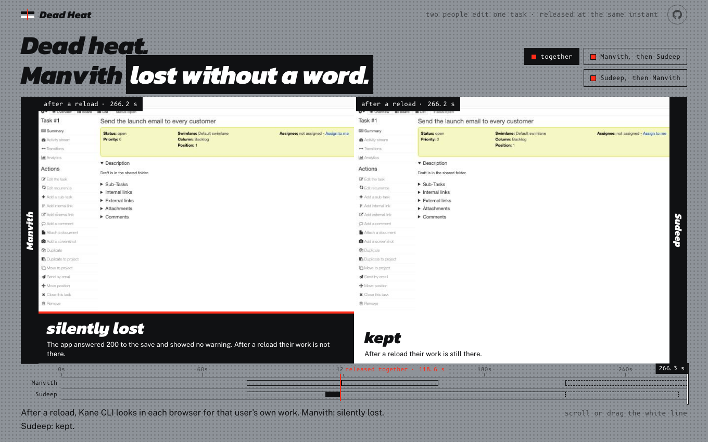

# Dead Heat

**Two real users. One instant. Who silently lost?**

Most web apps are only ever tested by one user at a time. The bugs that lose people's work need two: both open the same record, both press save, and the app tells both of them "saved" while keeping only one.

Dead Heat makes that moment happen on purpose. [Kane CLI](https://www.testmuai.com/kane-cli/) drives two real browsers from plain-English instructions. Dead Heat freezes both save requests at a proxy, releases them at the same instant, and then has Kane CLI reload each browser and check whether that user's work is still there. A user who was told yes and whose work is gone has been **silently lost**, and the failure goes straight to your coding agent to fix.

Built for the [KaneCLI Online Hackathon](https://www.kaneclihack.sh/) by team Matcrypt (Sudeep and Manvith).

## What it found

**Kanboard 1.2.58** (about 10,000 stars on GitHub). Two people open the same task. Manvith rewrites the description, Sudeep changes the title, and both press Save. Users reported this in [kanboard#2741](https://github.com/kanboard/kanboard/issues/2741) and [kanboard#944](https://github.com/kanboard/kanboard/issues/944); both issues were closed without a fix, and the current release still behaves the same way.

| Saves released | Manvith's description | Sudeep's title | What Kanboard told them |
|---|---|---|---|
| at the same instant | **silently lost** | kept | answered 200 to both saves, no warning |
| Manvith, then Sudeep | **silently lost** | kept | "Task updated successfully." |
| Sudeep, then Manvith | kept | **silently lost** | answered 200 to both saves, no warning |



This is one real run on 21 November 2026: 12 Kane CLI runs, 266 credits, about 12 minutes. The full report, with every screenshot and a draggable timeline, is [`docs/kanboard-report.html`](docs/kanboard-report.html) (download it and open it in a browser).

In every order one person's edit disappeared, because Kanboard saves the whole form and the later save carries a stale copy of the other field. Both browsers showed Kanboard's green "Task updated successfully." banner and nobody was warned.

The setup script and race file are in [`examples/kanboard`](examples/kanboard), so the result can be reproduced with two commands.

## Try it in two minutes

You need Node 22 or newer, Google Chrome, and Kane CLI logged in (`npm install -g @testmuai/kane-cli`, then `kane-cli login`).

```bash
npm install -g github:SudeepGowda55/deadheat
git clone https://github.com/SudeepGowda55/deadheat && cd deadheat/examples/desk
deadheat race
```

`examples/desk` is a tiny booking page with one hot desk and a classic mistake: it checks that the desk is free, waits a moment, then books it. The run takes about six minutes and 150 Kane CLI credits, and ends like this:

```
✗ last desk · together · A USER SILENTLY LOST
    Manvith was told "Confirmed: the desk is yours, Manvith." and their work was kept.
    Sudeep was told "Confirmed: the desk is yours, Sudeep." and their work was SILENTLY LOST.
✓ last desk · first-then-second · clean
    Manvith was told "Confirmed: the desk is yours, Manvith." and their work was kept.
    Sudeep was told "Sorry, someone else just booked it." and their work was refused, and told so.
✓ last desk · second-then-first · clean
```

One after the other, the app behaves. Only the dead heat breaks it, which is why nobody caught it by hand.

## How it works

```
 Manvith ── Kane CLI ── Chrome ──▶ lane 4801 ─┐
                                              ├─ Dead Heat proxy ──▶ your app
 Sudeep  ── Kane CLI ── Chrome ──▶ lane 4802 ─┘
```

1. **Each user gets their own Chrome and their own port on the proxy.** Separate cookies, separate sessions, and Dead Heat always knows whose request is whose.
2. **Setup.** Kane CLI brings both users to the point where the old state is on their screen, for example logged in with the edit form open.
3. **Both act.** Kane CLI performs each user's action. When a save reaches the proxy it is frozen. The first user waits until the second user's save arrives too.
4. **The release.** Both saves reach your app together, or one after the other in either order. In all three cases both users had already read the old state.
5. **The check.** Kane CLI reloads each browser and verifies, in your own words, that this user's work is still there.
6. **The verdict**, per user:

| Outcome | Meaning |
|---|---|
| kept | Their work is there after a reload. |
| refused | Their work is not there, and the app told them so. This is correct behaviour. |
| **silently lost** | Their work is not there, and the app never said. This is the bug. |
| crashed | Their work is not there, and the app answered the save with a server error (5xx). A failure, but not a silent one, so it is reported separately. |

A retried click while a save is frozen is held as well, and a request the browser abandoned never reaches your app, so an impatient browser cannot fake a clean result.

## Describe a race

`deadheat init` writes a `deadheat.json`. A race is two users and a few plain-English sentences each:

```json
{
  "app": { "url": "http://127.0.0.1:8000", "start": "npm start", "reset": "cp seed.sqlite app.sqlite" },
  "races": [{
    "name": "two people edit one task",
    "hold": "POST /?controller=TaskModificationController&action=update*",
    "users": [{
      "name": "Manvith",
      "setup": "Log in with username \"manvith\" and password \"deadheat1\". Open the task \"Send the launch email\" and click \"Edit the task\".",
      "do": "Replace the description with \"Send it at 9 am on Monday.\" and click Save.",
      "kept": "Open the task \"Send the launch email\". Its description says \"Send it at 9 am on Monday.\"",
      "refused": "the page shows a warning saying that someone else changed this task"
    }]
  }]
}
```

The second user is written the same way. The full file is [`examples/kanboard/deadheat.json`](examples/kanboard/deadheat.json).

| Field | What it is |
|---|---|
| `app.url` | Where your app listens. It must be plain HTTP, which a local app is. |
| `app.start`, `app.reset` | Optional shell commands. Dead Heat restores the data and restarts the app before every order, so each race starts from the same state. |
| `hold` | The save request to freeze: a method and a path, with `*` as a wildcard. Leave it out to freeze the first request that is not a read. |
| `setup` | Optional. Gets the user to where the old state is on screen. |
| `do` | The action that ends in the save. |
| `kept` | What must be true after a reload if this user's work survived. |
| `refused` | What the screen says if the app turned this user down honestly. |
| `invariant` | Optional, per race. Something that must hold for everyone afterwards, such as "stock is not below zero". |

## The loop with your coding agent

```bash
deadheat fix --with "your-agent {brief}"
```

Dead Heat races every order. If a user silently lost, it writes a brief (what each user was told, which requests were frozen, what Kane CLI saw after the reload) and runs your agent's command with it. When the agent is done, Dead Heat restores the data, restarts the app and races every order again. It stops when every order is clean or after `--max` attempts.

The agent has to fix the app, not the test: if the race file changes during an attempt, Dead Heat restores it and stops.

Agents can also drive Dead Heat themselves. [`skills/deadheat/SKILL.md`](skills/deadheat/SKILL.md) is a skill file that teaches a coding agent when a handler needs a race, how to write one, and how to read the result. `deadheat race --agent` prints one JSON object per line, and the last line carries every verdict.

| Exit code | Meaning |
|---|---|
| 0 | Every order was clean. |
| 1 | A user silently lost, a save crashed the app, or the invariant broke. |
| 2 | The race could not be run (Kane CLI error, or the two saves were never frozen together). |

## The report

Every run writes `.deadheat/report.html`, a single file with the screenshots inside it, so it can be attached to a pull request as it is. It shows both users' screens side by side and a time track you can drag through the race: on the way to the save, frozen, released, what the app said, and after the reload. `.deadheat/report.md` and `report.json` hold the same facts for people and for tools.

## What Kane CLI does here

Dead Heat contains no selectors and no browser automation of its own. Kane CLI:

- performs every user's setup and action from the English in the race file, in a Chrome that Dead Heat opened for that user (`--cdp-endpoint`);
- reads what the app told each user and returns it in `final_state`;
- decides the outcome: the `kept` and `invariant` sentences are Kane CLI assertions, and their pass or fail is the verdict;
- supplies the evidence: every run's share link is in the report next to the user it belongs to.

Dead Heat adds the one thing a single test runner cannot do alone: it controls the instant at which two users' requests reach the server.

## Limits

- Two users per race.
- The app must be reachable over plain HTTP, and the save must be an ordinary HTTP request. WebSocket traffic passes through but is not frozen.
- A full race of three orders is about 12 Kane CLI runs: roughly 150 credits on a small page and 270 on a real app.
- Kane CLI retries a click after about five seconds without a response. Dead Heat holds those retries, but very slow flows can still time out; the verdict is then "no race happened", never a false "clean".
- The frozen moment is a few seconds long, so this finds lost updates and check-then-act bugs. It is not a load test.

## Development

```bash
npm test        # 9 tests, no Kane CLI or browser needed
```

| Path | What it is |
|---|---|
| `src/proxy.js` | The freezing proxy: one lane per user, held saves, release order |
| `src/browser.js` | One Chrome per user, and screenshots over its debugging socket |
| `src/kane.js` | Runs a Kane CLI objective and returns its final event |
| `src/race.js` | One race from setup to verdict |
| `src/fix.js` | The loop with a coding agent |
| `src/report.js`, `src/report.html` | Terminal summary, Markdown, JSON and the visual report |
| `skills/deadheat/` | The skill file for coding agents |
| `examples/desk`, `examples/kanboard` | The quickstart app and the Kanboard race |

Nothing in this repository existed before 21 November 2026.

## Licence

MIT.
